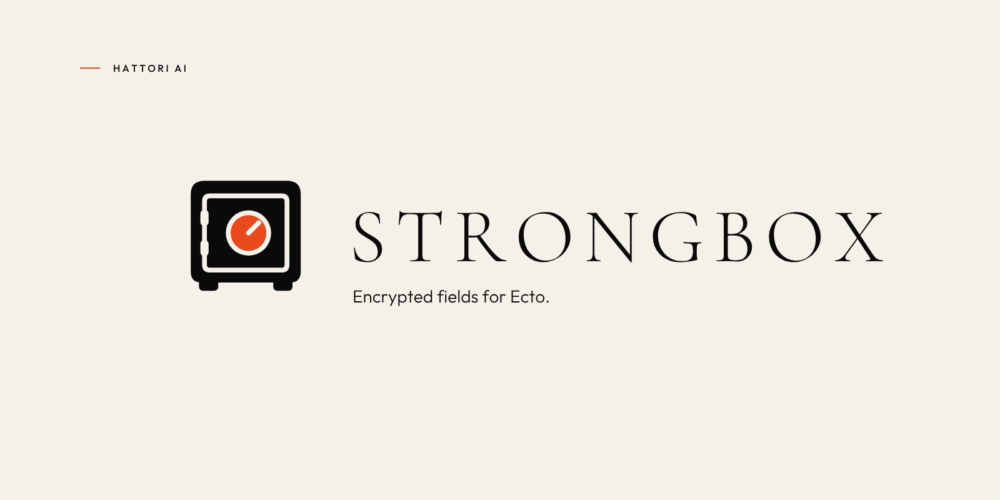

# Strongbox



<p>
  <a href="https://hex.pm/packages/strongbox">
    
  </a>
  <a href="https://hexdocs.pm/strongbox">
    
  </a>
  <a href="https://github.com/hattoriai/strongbox/actions">
    
  </a>
</p>

**Encrypted fields for Ecto: values bound to their field, blind indexes
to find them, and keys you can rotate.**

A national ID, a phone number, a token for another service, notes about
someone's health. Strongbox encrypts them in your app, before they reach
the database, so a leaked backup, a read replica or a query run by hand
shows only ciphertext. Your app reads them as it always did.

> Early release. Before 1.0, a minor version may change the API.

## Install

You need Elixir 1.17+ and Ecto 3.10+.

```elixir
{:strongbox, "~> 0.1"}
```

On Elixir 1.17, add `{:jason, "~> 1.4"}` too, for encrypted maps and
lists. 1.18 and later have their own `JSON`.

## Your first encrypted field

Make a key, and keep it out of the code:

```sh
$ mix strongbox.gen.key
lF1n2s0x…=
```

```elixir
# config/runtime.exs
config :my_app, :strongbox_key_k1, Strongbox.Key.decode!(System.fetch_env!("STRONGBOX_KEY_K1"))
```

A vault holds the keys:

```elixir
defmodule MyApp.Vault do
  use Strongbox

  @impl true
  def keys do
    [%{tag: "k1", key: Application.fetch_env!(:my_app, :strongbox_key_k1)}]
  end
end
```

Encrypt a field. Its column is `:binary`:

```elixir
defmodule MyApp.Patient do
  use Ecto.Schema
  use Strongbox.Schema, vault: MyApp.Vault

  schema "patients" do
    field :name, :string
    encrypted_field :national_id
    encrypted_field :born_on, as: :date
    encrypted_field :notes, as: :map
  end
end
```

```elixir
# the migration
add :national_id, :binary
add :born_on, :binary
add :notes, :binary
```

That's all: the fields are encrypted when saved and decrypted when
loaded, and never show when a struct is inspected.

## Finding a value again

Encrypted values can't be queried: the same value never encrypts twice
the same way. Keep a blind index beside the field, a keyed hash you can
look up:

```elixir
# the vault
@impl true
def index_keys do
  [%{tag: "i1", key: Application.fetch_env!(:my_app, :strongbox_index_key_i1)}]
end

# the schema
encrypted_field :email, as: :string
blind_index :email_index, of: :email, normalize: [:trim, :downcase]

# the changeset
|> cast(attrs, [:email])
|> Strongbox.Changeset.put_indexes()
|> unique_constraint(:email_index)
```

```elixir
Patient
|> Strongbox.Query.where_index(:email_index, "Ana@Example.com")
|> Repo.one()
```

The [blind indexes](guides/blind_indexes.md) guide has short indexes
that tell less, slow ones for values with few possibilities, and what an
index gives away.

## What you get

* **Values bound to their field.** A value copied into another column
  doesn't decrypt there, so someone who can write to the database can't
  move a secret to where it would be shown.
* **Keys checked before decrypting.** Each value names its key and
  carries a commitment to it, and a value changed by a single bit fails
  to decrypt. AES-GCM or ChaCha20-Poly1305 from Erlang's `:crypto`.
* **Blind indexes.** Lookups, unique constraints, normalization; a key of
  their own per index; short or slow hashes when it matters.
  → [Blind indexes](guides/blind_indexes.md)
* **Keys you can rotate.** Put a new key first, deploy, and run
  `Strongbox.Rotation.run/3`, which writes again only what is stale and
  never overwrites a write made meanwhile. → [Rotation](guides/rotation.md)
* **Padding.** `pad: 64` hides a value's length up to 64 bytes, for
  fields whose length tells something.
* **Readable without Strongbox.** The format is documented byte by byte,
  and a vault can write `Ecto.Encrypted`'s own. → [Format](guides/format.md)
* **Values Cloak or `Ecto.Encrypted` wrote.** Strongbox reads them as they
  are and writes them again in its own format as keys rotate.
  → [From Cloak](guides/from_cloak.md)
* **No process.** A vault is a module; there is nothing to start.

## Guides

* [Keys](guides/keys.md): making them, keeping them, how many.
* [Blind indexes](guides/blind_indexes.md): finding encrypted values.
* [Rotation](guides/rotation.md): new keys, and the old values.
* [From Cloak](guides/from_cloak.md): moving over a Cloak vault.
* [Format](guides/format.md): each byte of a value and a hash.

## License

MIT. See [LICENSE](https://github.com/hattoriai/strongbox/blob/main/LICENSE).
